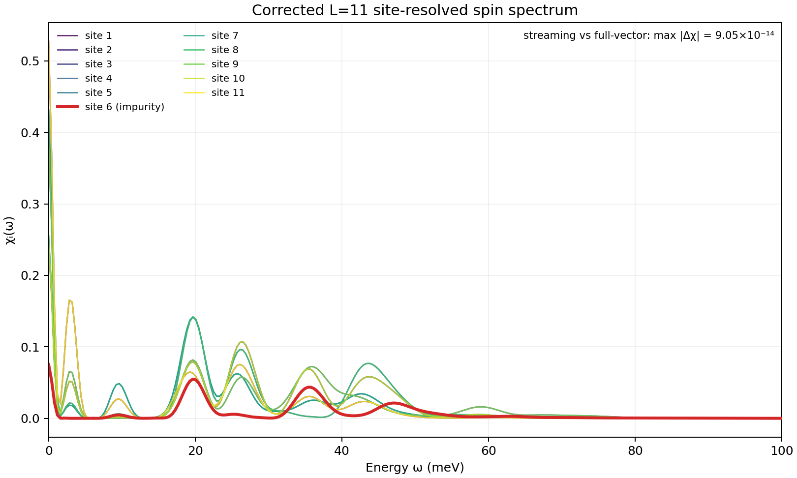

# aiida-itensor-spin

Adaptation of the spin-chain ITensor code developed by
[Gonçalo Catarina (@GCatarina)](https://github.com/GCatarina).

Experimental, restart-safe AiiDA orchestration for the Julia/ITensor spin-chain
spectral calculation on Daint/ALPS.

The central unit is a **spectral segment**: one bounded Slurm allocation reads
an immutable ground-state checkpoint and, optionally, the immutable state of a
previous segment. It writes a new state plus `segment_status.json`. The
`SpinSpectraWorkChain` submits bounded segments until all spectral task IDs are
validated, and the node/process/thread layout may change between segments.

## Scientific correction and validation

The corrected convention is `chebyshev-2n-minus-1-v2`: `N` stored Chebyshev
vectors determine exactly `2N-1` moments, `mu_0` through `mu_(2N-2)`. Legacy
files are rejected by explicit format and convention checks.

The repository contains two independently exercised implementations:

- `remote/engine/ITensor_libs/SpectralFunction.jl` is Gonçalo's original
  full-vector implementation with only the `2N` to `2N-1` correction;
- `remote/engine/SpectralFunctionCheckpointed.jl` is the restartable,
  memory-saving implementation used by AiiDA.

A fresh corrected L=11 ground state and all 33 spectral tasks completed on
2026-08-15. A deliberately interrupted streaming calculation resumed from
`n=12` with a different worker layout. Its collected spectrum agrees with the
independent corrected full-vector calculation to a maximum absolute difference
of `9.048317650695026e-14` (acceptance tolerance `1e-10`). See
[`results/L11/README.md`](results/L11/README.md) and the compact retained result
files.

## Repository layout

- `src/aiida_itensor_spin/`: CalcJobs, parsers, input contracts, and WorkChains;
- `remote/engine/`: Julia environment, ITensor libraries, GS preparation,
  checkpointed spectral workers, progress validation, and collection;
- `remote/itensor-spin-gs` and `remote/itensor-spin-segment`: Daint-side AiiDA
  executables;
- `examples/submit_l11.py`: reproducible fresh GS plus forced-stop/resume test;
- `results/L11/`: corrected streaming and full-vector results and provenance.

Ground-state checkpoints are retrieved once as AiiDA `SinglefileData`.
Recurrence checkpoints and final task files stay on Daint and pass between
segments as immutable AiiDA `RemoteData`. Repartitioning a continuation does
not modify or discard the preceding segment.

## L=11 result for Gonçalo to review

| Item | Value |
|---|---|
| Chain and impurity | `L=11`, impurity at site `6` |
| Couplings | `J=18.4 meV`, `Jp=16.7 meV` |
| Spectral grid | `0–100 meV`, smearing `2 meV` |
| Work completed | 1 ground state, 11 sites × 3 channels = 33 tasks |
| Corrected moments | `N` Chebyshev vectors produce `2N-1` moments |
| Restart test | stopped at recurrence `n=12`, then resumed and repartitioned |
| Independent check | streaming versus corrected full-vector result |
| Maximum absolute difference | `9.048317650695026e-14` (tolerance `1e-10`) |



Please check whether this L=11 spectrum and the corrected moment convention are
physically as intended. The directly readable spectrum is
[`results/L11/streaming/spectrum.tsv`](results/L11/streaming/spectrum.tsv); the
complete compact JLD2 output and independent reference result are documented in
[`results/L11/README.md`](results/L11/README.md).

## Current installation and L=11 example

The validated Daint engine is isolated at:

```text
/capstor/scratch/cscs/cpi/goncalo/parallel/aiida_spin_engine_v2
```

The validated AiiDA codes are:

```text
itensor-spin-gs-0.2.0-exp@daint.alps_lp83
itensor-spin-segment-0.2.0-exp@daint.alps_lp83
```

From this repository, submit the complete fresh validation with:

```console
verdi run examples/submit_l11.py
```

The example deliberately uses two spectral layouts: 2 nodes x 4 processes x 2
threads, stopped at recurrence `n=12`, followed by 2 nodes x 6 processes x 2
threads. For an ordinary calculation, remove `stop_after_n`; resource layouts
can still change naturally on later wall-time continuations.

Local checks:

```console
pip install -e .
pytest -q tests
pip check
```

## Physics inputs to review with Gonçalo

The WorkChain intentionally exposes only chain `length`, `impurity_site`, and
random `seed` until the physical interface is agreed. The fresh L=11 test kept
the working-case values: `J=18.4 meV`, `Jp=16.7 meV`, `T=4 K`, frequency range
`omega_max=100 meV`, and smearing `2 meV`.

Before widening the interface, please classify the following as user physics
inputs or expert numerical controls:

- model/physics: `J`, `Jp`, temperature, frequency range, frequency smearing;
- GS numerics: bond dimension, DMRG cutoff, energy tolerances, number of excited
  states, and orthogonality penalty;
- algorithm controls: double-moment construction, backend, and threading mode.

After Gonçalo's review, we plan to expose the agreed physical quantities as validated WorkChain inputs while keeping numerical controls in an expert section. Larger production cases should wait for that review. The corrected spectral
code and the restart/repartition machinery are now independently validated.

## Legacy provenance

Earlier WorkChains and Daint files using the old `2N`-slot convention are
retained for provenance and debugging only. Their last moment was an untouched
zero, so they are not scientific references for v2.
