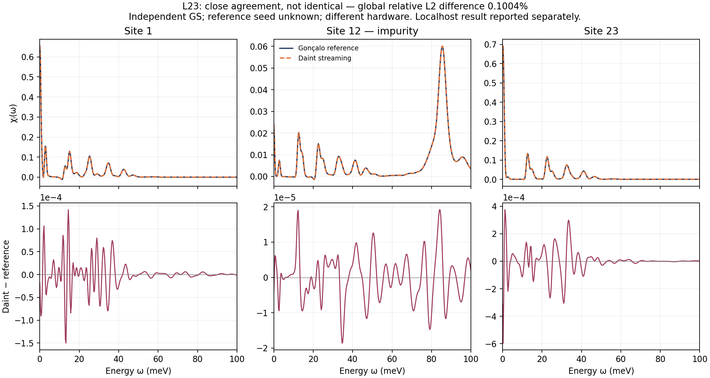

# L23 validation results — 17–18 September 2026

The Daint experiment completed all 69 spectral tasks before the 14:00 CEST
maintenance deadline. The standard AiiDA continuation finished successfully
(`Finished [0]`). A second complete AiiDA run then finished in a Linux ARM64
container on Apple Silicon. Both are close-agreement comparisons for review,
not claims of exact numerical reproduction.

## Comparison with Gonçalo Catarina's supplied reference

Both runs use J=18.4, JL=16.7, JR=51.1 meV, impurity site 12,
DMRG cutoff 1e-8, spectral cutoff 1e-6, and broadening 1.5 meV.
Our ground state was computed independently with seed 20260724; Gonçalo's
ground-state checkpoint, seed, and Julia environment were not supplied.
**We did not use a shared, controlled random seed or the same GS checkpoint.**
The supplied reference script does not call `Random.seed!`. Its actual seed is
unknown, so we cannot identify it or prove that seed differences alone explain
the discrepancy. The systems also ran on different hardware and potentially
different library versions.

| Quantity | Observed comparison |
|---|---|
| Sites / sampled frequencies | 23 / 333, all values finite |
| Relative spectral L2 difference | 0.001003628122765067 = 0.1003628% |
| Maximum absolute spectral difference | 0.0005961260218316777 |
| Largest per-site relative integrated-weight difference | 0.0075282% |
| Positions of per-site global maxima on the sampled grid | Match at all 23 sites |
| Ground-state energy, this run | -574.5775840675033 meV |
| Ground-state energy, reference | -574.5775840718105 meV |
| Absolute GS energy difference | 4.3072532207588665e-9 meV |

The spectra agree closely but are not identical. No acceptance threshold was
specified in advance, and no post-hoc pass criterion is imposed here.
These metrics alone do not establish the cause of the residual differences.
An independent local h5py/NumPy comparison of the retrieved TSV against the
original reference JLD2 reproduced the Julia comparison exactly.

Detailed results: [spectrum.tsv](streaming/spectrum.tsv),
[comparison.toml](streaming/comparison.toml),
[per-site comparison](streaming/comparison_by_site.tsv),
[collection report](streaming/collection_report.txt), and
[task timings](streaming/task_timings.tsv).
The final compact Julia result is [chi_L23.jld2](streaming/chi_L23.jld2).
The [reference and exact tested code](../../examples/l23_goncalo_20260917/README.md)
are retained alongside the experiment. The measured runtime used Julia 1.12.6,
ITensors 0.9.30 and ITensorMPS 0.4.1.

## Actual resource use and timing

Times below are Slurm elapsed times, including executable startup and output
handling within each allocation, but excluding gaps between allocations.

| Stage | Nodes | Processes | Threads/process | Slurm elapsed |
|---|---:|---:|---:|---:|
| Fresh ground state | 1 | 1 | 8 | 2 min 08 s |
| First spectral segment | 1 | 23 | 2 | 26 min 21 s |
| Checkpoint continuation | 1 | 4 | 2 | 4 min 49 s |
| Sum of allocated elapsed time | | | | **33 min 18 s** |

The first segment has **23 concurrent spectral tasks**, not 69: each process
has three sequential tasks. Workers advance independently, without a global
batch barrier. The two threads cooperate within a task's tensor operations.
Most workers finished early; the impurity-site channels dominated the tail.

The first segment's requested walltime was 30 minutes, with a 26-minute
internal stop. It stopped cleanly at 65/69 tasks; task 34 was saved at
306/326 recurrence vectors and task 35 at 322/326. Tasks 57 and 58 had not
started. The first full workflow exhausted its deliberately configured
`max_segments=1` limit, returning exit 503 after its child stopped at the
segment limit. This is not an uninterrupted successful full-workflow run.

A new **standard** `itensor_spin.spectra` WorkChain used the same GS,
same Code, immutable parent RemoteData, and a provenance-recorded resource
calcfunction. The planner selected one node with four processes and two
threads each. The worker logs explicitly confirm resumption at iterations
307 and 323. It imported all 65 completed tasks and completed 69/69.
Its requested walltime was 20 minutes, with the same 14:00 scheduler deadline.
No existing scientific inputs or provenance nodes were edited.

First GS allocation began at 13:02:48 CEST; the final spectral allocation
ended at 13:40:33: **37 min 45 s** including inter-allocation gaps.
AiiDA recorded the successful continuation at 13:41:49 CEST.
Gonçalo's supplied summary reports **44 min 43.812 s** for his scientific
pipeline, starting after imports. These are not identical timing boundaries
or hardware, so they are not a controlled speedup benchmark.

Gonçalo's log records approximately 24 min 53 s for building the impurity chi_zz
Chebyshev vectors alone (324 logged steps), before calculating its moments.
This explains why increasing task concurrency cannot yield a speedup
proportional to 23/6. Our live per-iteration timer also includes moment
contractions; his vector-building timer does not.

## Localhost ARM64 AiiDA result — 18 September 2026

The generalized workflow was installed in the Linux `aarch64` AiiDAlab
container and submitted through AiiDA's standard `localhost` computer. The GS
used all eight visible CPU threads; the resource planner then selected one
local node with four independent processes and two threads/process. Every
spectral worker received 17 or 18 statically assigned tasks.

| Quantity | Localhost result |
|---|---:|
| GS elapsed | 1 min 22 s |
| Spectral segment elapsed | 40 min 23 s |
| Complete WorkChain elapsed | **41 min 48 s** |
| Completed tasks / recurrence units | 69/69 / 22494/22494 |
| Relative spectral L2 difference | 0.0010057006107395804 = **0.1005701%** |
| Maximum absolute spectral difference | 0.000595390035954213 |
| Largest per-site relative integrated-weight difference | **0.0075104%** |
| Sampled per-site peak positions | Match at all 23 sites |
| Absolute GS-energy difference | 4.308844836486969e-9 meV |

The reference and localhost run did not share a GS checkpoint. The localhost
seed was 20260724, while the reference seed is unknown. Consequently this is
an independent physics reproduction, not an implementation-equivalence test.
The common ARM64 architecture class also does not establish identical CPU
models or a controlled performance comparison. Gonçalo's reported scientific
pipeline took 44 min 43.812 s with different timing boundaries; the two wall
times should therefore be described as comparable, not as a measured speedup.

The expensive impurity-site tasks dominate the critical path: site 12 took
approximately 19.4, 18.3 and 14.4 minutes for the `zz`, `pm` and `mp` channels.
This measured heterogeneity motivates a future cost-aware or dynamic task
assignment; merely changing thread/process decomposition on the same eight
cores cannot provide a large gain.

Retained local outputs: [compact JLD2](localhost/chi_L23.jld2),
[spectrum](localhost/spectrum.tsv), [task timings](localhost/task_timings.tsv),
[comparison summary](localhost/comparison.toml),
[per-site comparison](localhost/comparison_by_site.tsv),
[segment status](localhost/segment_status.json), and
[resolved GS inputs](localhost/ground_state.json).

Localhost durable provenance:

- Complete WorkChain: `86cab293-1dea-474d-b6de-7b7e033fac2f`
- GS CalcJob: `4b2b02a1-a79b-453b-8f35-8426c325e31c`
- Spectral WorkChain: `c773a3f2-8241-4350-8420-85ca3cac4f8e`
- Spectral CalcJob: `2d0f839e-9544-47c2-acfb-a758149b03e1`
- GS checkpoint SHA-256: `0599b69750513911930ebf47372e458962eec394a91c7e1b5e9c4199c875b936`
- Final JLD2 SHA-256: `4828801afc06e8f5094d1c5fe3592e796d84bfd3576d0b52543185601b1ce188`
- Final TSV SHA-256: `0bdacfd2bebac93a82fe3b807ba740748f19901c8f0ee708133ffa5aee187a96`

## Daint durable provenance

- Original full workflow: `b77905ce-9474-446a-a7f7-bd5ceb4df292`
- GS CalcJob: `2de433a2-4bf1-47d5-bff2-51344401a84d`
- First spectral CalcJob: `7b8e354b-f9b6-4ea7-b0bb-8d512a5ebb01`
- Successful continuation WorkChain: `aca6cff5-57c3-427a-81d2-77ebc15d6ee6`
- Final spectral CalcJob: `70b6d6cb-ad7f-4a86-a964-d017ce79eff2`
- GS checkpoint SHA-256: `c543cc77c399ad84b340e626bfdf2a1a9480ed04d9948be138672dfa7504eafd`
- Final JLD2 SHA-256: `1b108f6496d5c0cb69be2b6cebd2623ecf59c2491c8f3ef6d3de7ebd64b51f40`
- Final TSV SHA-256: `6b9c3410a92dbbee8498bf02369c3ad0ed22bba8ad61f7cbb1accf094c6d932c`
- Reference JLD2 SHA-256: `c3c9d0bdf7024c511f7259e16533a3556d6ad4b94655f997c8e5328589ef4d46`

The tested engine is based on recovery commit
`210f0830c3e360a09c84acd8a25c8715062c9775`, with the isolated input adaptations
documented in the example. This publication does not change the installed
workflow, production engine defaults, or L101 calculations. Large ground-state
and recurrence checkpoints are intentionally not stored in Git.
