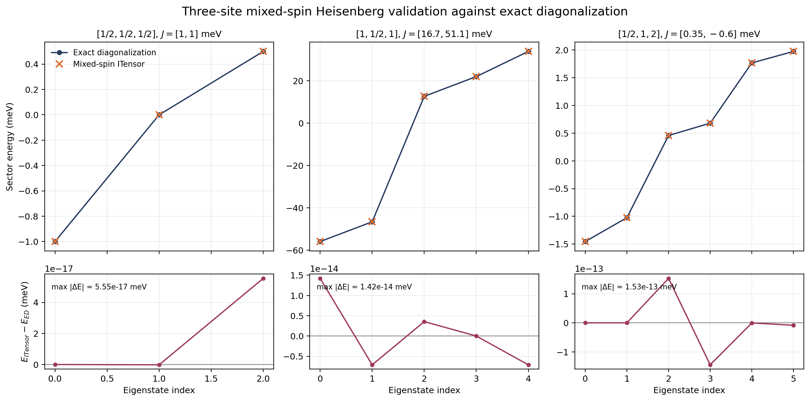
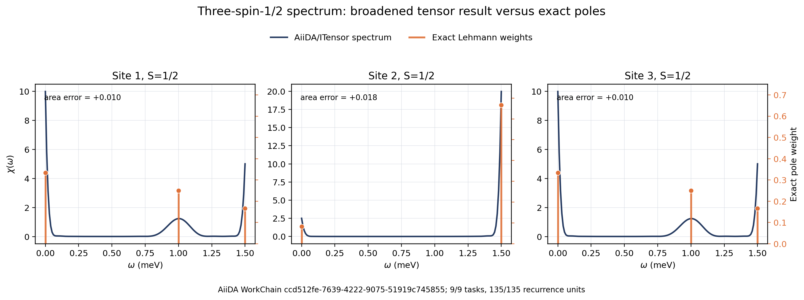
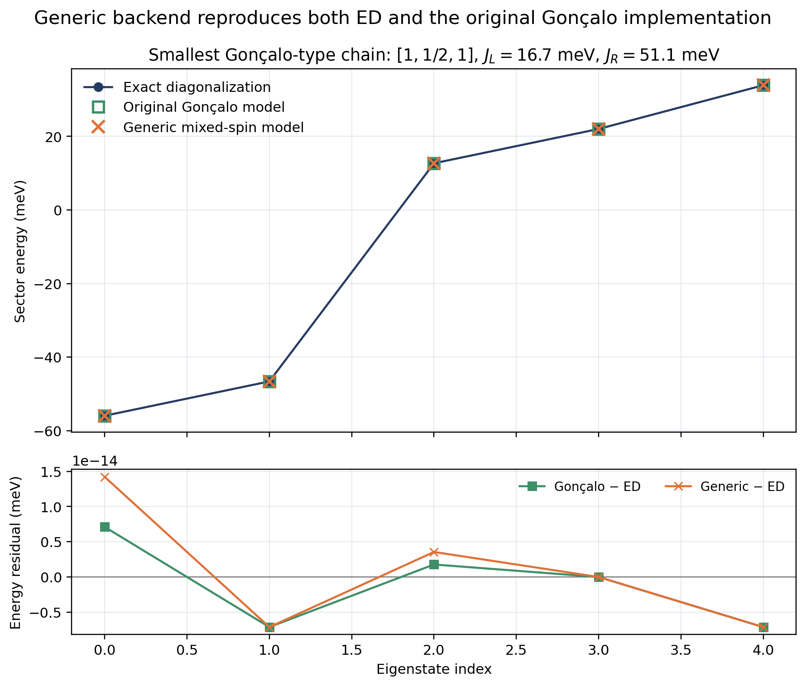
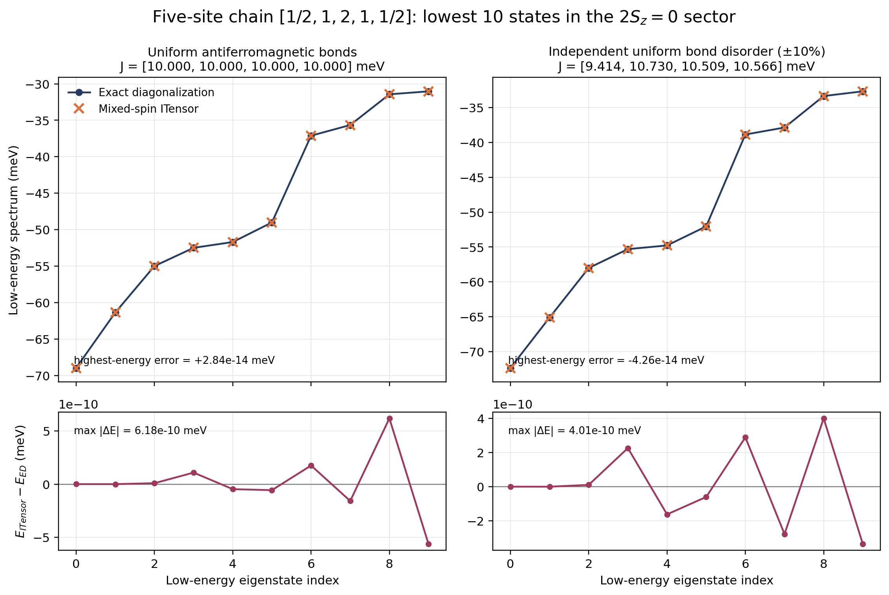

# Short-chain exact-diagonalization validation

The dense reference in `exact_diagonalization.py` is intentionally independent
of ITensor and AiiDA. It constructs arbitrary integer/half-integer spin matrices
and the full Heisenberg Hamiltonian directly with NumPy.

## Existing Gonçalo model

The smallest current impurity model is (L=3), with site spins
`[1, 1/2, 1]`, (J_L=16.7) meV, (J_R=51.1) meV, and conserved
(2S_z=1):

```console
python validation/compare_smallest_goncalo.py \
  --output validation/results/smallest_goncalo_L3.json
```

All five sector energies and the highest energy agree with dense ED to
(7.11\times10^{-15}) meV.

## Generic mixed-spin model

The versioned model `mixed_spin_heisenberg_chain_v1` accepts:

- `site_spins`: one positive integer or half-integer spin per site;
- `couplings_meV`: one isotropic Heisenberg coupling per nearest-neighbour
  bond;
- `target_twice_sz`: an optional conserved (2S_z) sector. The default is
  the smallest non-negative sector compatible with the spins.

Run the three independent GS regressions with:

```console
python validation/compare_mixed_spin.py \
  --output validation/results/mixed_spin_L3_ed.json
```

They cover three spin-½ sites, the exact Gonçalo-equivalent
`[1, 1/2, 1]` system, and `[1/2, 1, 2]` with competing ferro- and
antiferromagnetic bonds. The maximum energy error is
(1.53\times10^{-13}) meV. The generic Gonçalo-equivalent energies also agree
with the legacy tensor backend.

The complete checkpointed spectral pipeline was tested for the three-spin-½
chain (9 tasks: 1 state × 3 sites × 3 channels). It completed all 135
recurrence units. Compare its `spectrum.tsv` with exact Lehmann data using:

```console
python validation/validate_spectrum_against_ed.py spectrum.tsv \
  --output validation/results/mixed_spin_L3_spectrum_ed.json
```

The tensor spectrum reproduces the exact poles at 0, 1, and 1.5 meV, satisfies
the local (S(S+1)=0.75) sum rule, and matches the exact finite-window
broadened areas within 0.018 (acceptance tolerance 0.03).

The post-GS contract now rejects a requested `omega_max_meV` larger than the
computed (E_{max}-E_0), before spectral resources are allocated.


## Five-site validation

The larger validation chain is

```text
site spins = [1/2, 1, 2, 1, 1/2]
target 2Sz = 0
full Hilbert dimension = 180
sector dimension = 34
```

Two bond patterns were tested:

- uniform antiferromagnetic `J = [10, 10, 10, 10]` meV;
- reproducible independent uniform ±10% disorder around 10 meV, seed
  `20260919`, giving
  `J = [9.4142657194, 10.7302704173, 10.5088355747, 10.5660656559]` meV.

The lowest ten sector energies and the highest sector energy were compared with
dense ED. The maximum low-energy errors were $6.18\times10^{-10}$ meV
(uniform) and $4.01\times10^{-10}$ meV (disordered); highest-energy errors
were below $4.3\times10^{-14}$ meV.

Reproduce with:

```console
python validation/compare_mixed_spin_l5.py \
  --output validation/results/mixed_spin_L5_ed.json
```

## Plots

The validation figures are available as both PNG and vector PDF:

1. All three generic short-chain energy spectra versus exact diagonalization,
   including signed residuals:
   [PNG](results/mixed_spin_L3_energy_comparison.png) ·
   [PDF](results/mixed_spin_L3_energy_comparison.pdf)

   

2. The complete AiiDA/ITensor spectrum for the three-spin-1/2 chain versus
   exact Lehmann pole positions and weights:
   [PNG](results/mixed_spin_L3_spectrum_comparison.png) ·
   [PDF](results/mixed_spin_L3_spectrum_comparison.pdf) ·
   [raw AiiDA spectrum](results/mixed_spin_L3_aiida_spectrum.tsv)

   

3. The smallest Gonçalo-type chain as a three-way energy comparison: exact
   diagonalization, the original Gonçalo model adapter, and the new generic
   mixed-spin adapter:
   [PNG](results/smallest_goncalo_L3_comparison.png) ·
   [PDF](results/smallest_goncalo_L3_comparison.pdf)

   


4. The L=5 uniform and bond-disordered cases versus ED:
   [PNG](results/mixed_spin_L5_energy_comparison.png) ·
   [PDF](results/mixed_spin_L5_energy_comparison.pdf) ·
   [numerical report](results/mixed_spin_L5_ed.json)

   

The Gonçalo comparison currently covers the complete energy spectrum in the
selected sector. A same-checkpoint or same-seed full spectral comparison with
the original Gonçalo adapter would be a separate controlled calculation.

## AiiDA acceptance

On 2026-09-19, `SpinChainWorkChain<12094>`
(`ccd512fe-7639-4222-9075-51919c745855`) finished successfully on localhost.
It created GS CalcJob `12095`, resource-plan CalcFunction `12101`, spectral
WorkChain `12103`, and spectral CalcJob `12105`. The latter completed 9/9
tasks and 135/135 recurrence units with three processes and two threads per
process. The retrieved AiiDA `spectrum` output passed the same independent ED
comparison. Compact provenance is retained in
`results/mixed_spin_L3_aiida_acceptance.json`.
